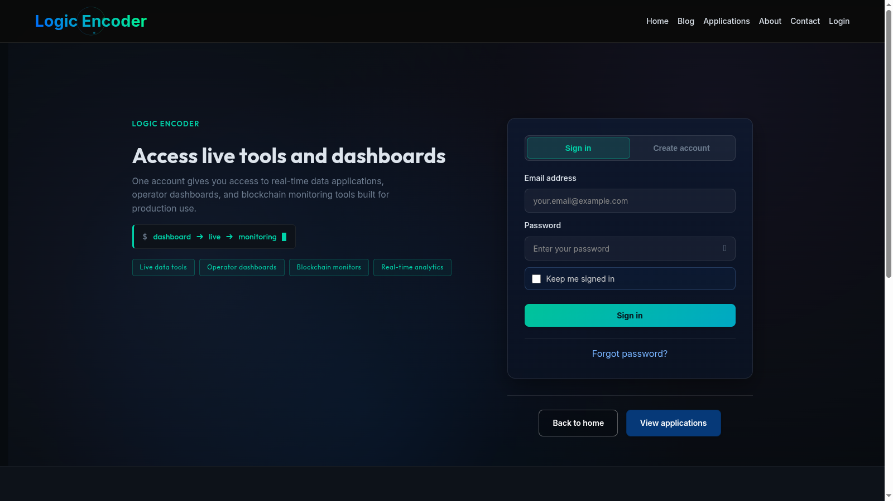

# Logic Encoder Login System

Member access involves more than a login form: people need to register, verify their address, recover access and reach the content meant for them. Logic Encoder Login System brings these journeys and their administration together in WordPress.

## Tech stack

| Layer | Technologies |
|---|---|
| Application | PHP, WordPress |
| Supporting technologies | HTML, CSS, JavaScript |

## A coherent member journey

Login and registration pages provide the starting point for new and returning members. Email verification gives the user a clear next step after registration, while account and contact surfaces support ongoing use. The aim is a connected journey rather than unrelated forms.

## Recover access without a manual exchange

Forgot-password and reset flows let members resolve common access problems themselves. Clear email communication supports those steps. Administrators can maintain the templates so the messages fit the site's presentation and instructions.

## Control access to content

Restriction controls let the owner decide which content and downloads are available to members. The visitor sees the appropriate access path, while the operator maintains those choices in administration. This connects the public site with its membership model.

## Manage users and communication

User administration and settings give the operator a place to maintain access. Email logs help investigate whether a relevant message was sent, while template controls support consistent communication. Unsubscribe handling covers the corresponding communication preference.

## Support and maintenance

Dashboard information, debug logs and cleanup controls assist when a member reports a problem. The public login screenshot shows the entry experience; registration, recovery, account and administrator views would make the full journey easier to understand.

---

Private code: [logicencoder-login-system-plugin](https://github.com/logicencoder/logicencoder-login-system-plugin)

See [REPOS.md](REPOS.md) for related repositories.

**[Logic Encoder](https://logicencoder.com)** · [GitHub](https://github.com/logicencoder) · [Contact](https://logicencoder.com/contact/)
